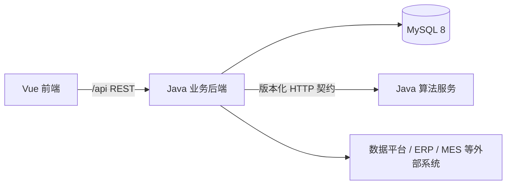

# SCOS 工程

采用前后端分离架构，同仓管理、独立构建和部署。原始 Demo 保留在仓库根目录的 `4-业务蓝图-DEMO/demo/`。

```text
scos_proj/
├── scos前端/                 # Vue 3 / TypeScript，已有导航和页面骨架
├── scos后端/                 # Java 17 / Spring Boot 3，模块化单体骨架
└── scos算法/                 # 六个独立构建、版本与验收的 Java/Maven 业务包
```



图中的数据库、算法服务和外部系统是目标架构，当前尚未接入。算法核心独立打包为 Java JAR，服务适配层采用 Java / Spring Boot，已按六个业务包建立独立骨架，后续实现各包服务适配，不将求解器放进浏览器或 Java Web 请求线程。

- [六个独立算法/分析包与验收范围](scos算法/README.md)
- [架构检查与当前缺项](docs/architecture-status.md)
- [前端启动与检查](scos前端/README.md)
- [后端启动与当前实现范围](scos后端/README.md)
- [后端架构与模块边界](scos后端/docs/architecture.md)
- [算法接入与异步任务设计](scos后端/docs/algorithm-integration.md)
- [API 约定和落地顺序](scos后端/docs/api-contract.md)

开发时前端运行于 `127.0.0.1:5173`，后端运行于 `127.0.0.1:8080`；前端已配置 `/api` 开发代理。当前前端保持默认 Mock 模式，后端仅提供健康检查，业务接口落地后再启用 HTTP 数据源。生产环境通过反向代理分发静态资源和 `/api` 请求。
