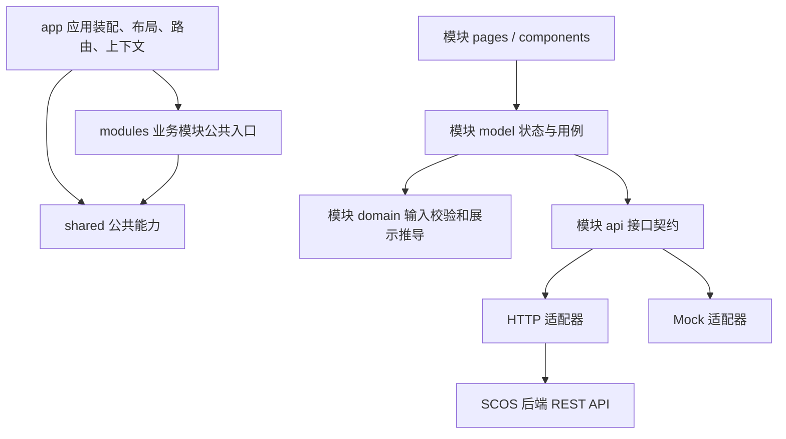

# 前端代码架构

## 1. 目标与依据

将 `4-业务蓝图-DEMO/demo` 中已经验证的业务页面与交互逐步迁入独立工程，保留原 Demo 供评审和对照。本次仅搭建目录和基础设施，不承诺业务功能已完成。

技术选型遵循仓库 `5-技术蓝图-终态/SCOS技术蓝图编写规范v1.0.md` 第 5 节及《02-总体架构设计》2.4.1.2：Vue 3、TypeScript、Vite、Element Plus、ECharts、Vue Router、Pinia、ESLint、Prettier、Vitest、Playwright。HTTP 使用 Axios。

官方参考：[Vue 工程入口](https://vuejs.org/guide/quick-start.html)、[Vue 状态管理](https://vuejs.org/guide/scaling-up/state-management.html)、[Vite](https://vite.dev/guide/)、[Vue Router](https://router.vuejs.org/guide/)。依赖选用经过兼容关系核对的稳定版本，具体版本及传递依赖以锁文件为准。

## 2. 分层与依赖



- `app` 负责装配所有业务模块，不承载库存或采购算法。
- `modules` 按业务领域划分，禁止直接修改其他模块的 store 或内部模型。
- `shared` 不依赖 `app` 和 `modules`。ESLint 已限制其通过 `@/` 反向导入；相对路径绕过由代码评审禁止。
- 模块间只通过 `index.ts` 暴露的类型/用例和后端版本标识交互，不共享可变业务数据副本。
- 大型页面、图表和业务子页按需加载。当前每个模块共用一个占位页面，正式迁移时拆成独立页面和组件。

## 3. 业务模块与职责

| 模块         | 页面范围                                   | 职责边界                                                         |
| ------------ | ------------------------------------------ | ---------------------------------------------------------------- |
| dashboard    | 驾驶舱                                     | 消费指标、地图、预警及执行结果；不维护上游主数据                 |
| sandbox      | 情景推演                                   | 快照与参数编辑、模拟任务、结果比较、采纳建议；正式优化由后端承接 |
| inventory    | 总览、策略、计划、异常、健康度             | 成品补充与库存策略，不生成原料采购订单                           |
| procurement  | 总览、供应商、预测、方案、滚动、执行       | 供应商选择与采购量分配，不负责每天送货排班                       |
| requisition  | 总览、条件、日计划、执行、滚动、异常、禁运 | 在有效合同范围内安排每日到货，不替代采购签约                     |
| costing      | 谱系、批次成本、多维盈利、管理决策         | 分层展示成本证据、传导和订单汇总，不在前端执行财务关账           |
| traceability | 全程批次追溯、质量影响分析                 | 消费独立追溯包结果，成本传导仍由 costing 负责                    |
| system       | 用户组织、规则参数、任务、审计             | 全局能力；业务专属规则仍归属业务模块                             |
| integrations | 生产计划协同                               | 外部能力适配；生产扰动模拟未接入时显示“未评估”                   |

本期不建设精益排程模型，生产计划保持外部系统对接。按用户补充范围，全程追溯与质量协同已独立为 traceability 模块，对应独立 Java 业务域和算法包；原 `/integrations/trace` 地址重定向至 `/traceability/query`。

## 4. 模块内部约定

```text
modules/<business>/
├── index.ts                 # 对外导出
├── routes.ts                # 路由定义
├── pages/                   # URL 对应页面，组合工作区
├── components/              # 本模块表单、表格、图表、弹窗
├── model/
│   ├── module.ts            # 导航与页面元数据
│   ├── types.ts             # 业务视图模型
│   └── *.store.ts           # 状态及异步用例，按实际需求创建
├── api/
│   ├── *.repository.ts      # 页面所需的接口契约与数据源选择
│   └── *.http.ts            # HTTP 调用与 DTO 到视图模型的转换
├── domain/                  # 纯函数：校验、格式转换、展示推导
└── mocks/                   # 同契约样例，明确标识数据性质
```

当前以 `dashboard` 实现最小端到端示例，其余模块只建立公共入口、路由、占位页面、初始视图类型与目录，不预造大量未使用的 service/store。

## 5. 状态与数据

- 全局：当前组织、导航状态等在 `app/stores`；身份与权限接入后集中管理，当前不模拟用户登录。
- 模块：查询结果、草稿、任务状态位于对应 `model/*.store.ts`。组件瞬时状态保留在组件内。
- URL：页面地址已通过 Router 管理，后续查询条件、页码和对象 ID 进入 URL，支持刷新与分享。
- 服务端：正式方案、审批、权限、规则版本、审计和计算结果由后端持有；Pinia 不构成权威存储。
- 跨模块：传递 `snapshotId / planId / version / jobId`，由接口查询一致版本；不直接引用另一模块的可变数组。
- 金额、数量、时间的正式口径在接口联调时确定；当前类型用于骨架，不代表已冻结的数据契约。

## 6. 数据源与错误

开发默认 Mock，生产默认 HTTP；生产构建显式配置 Mock 会失败。仅接口适配器决定数据来源，组件不知道数据来自样例还是网络。HTTP 失败显示错误并允许重试，不悄悄显示旧样例数据。

请求层统一基础 URL、超时、请求 ID 和用户可读错误。当前采用同源 `/api`，不自行管理令牌；企业认证、CSRF 与服务端会话联调后接入。审批/发布等操作不做自动重试，需服务端幂等键及版本校验。

页面需要区分加载中、无数据、加载失败、未评估、草稿、已发布等状态。用户可以明确识别示例数据；禁用按钮不能替代后端权限和状态检查。

## 7. UI 和图表

- `PageHeader` 统一标题与主操作；`ModulePlaceholder` 仅用于骨架，后续由业务页面替换。
- 通用可视化通过 `ScosChart` 管理初始化、响应尺寸与销毁；`shared/charts/echarts.ts` 统一注册所需图表。
- 业务图表 option 由各模块生成，不向共享组件塞业务判断。
- 当前仅注册线、柱、饼图；地图、桑基、关系图迁移时按需扩展，不复制旧 `charts` 全局对象。
- 主题变量在 `app/styles/tokens.css`，业务样式优先在 Vue SFC 内局部定义。
- 表格后续使用服务端分页，复杂查询不全量下载；弹窗、按钮与错误态保留键盘操作和可见焦点。

## 8. 质量门槛与扩展

当前配置包括严格 TS、lint、格式检查、单元测试及路由端到端检查。单元测试优先覆盖数据转换、约束、失败分支和状态流转；不要为纯占位页重复写快照。

正式业务迁移前确认后端 OpenAPI、认证协议和组织数据范围；建立 API DTO 映射后再补分页、字典、文件上传、异步任务轮询、审批组件。未经实际复用，不提前抽象“大一统”表格或通用业务流程引擎。

## Repository 与 Mock 边界

业务页面、组件和 model 不直接导入 mocks，也不直接读写浏览器存储。业务记录通过模块 api 访问；repository 内选择 HTTP 或懒加载 Mock 适配器，Mock 的持久化代码放在 mocks。业务契约放 model，共享成品需求契约放 shared/types；纯比较函数放 domain 或 shared/lib。

库存策略与月周计划、成品需求发布、要货协调与禁运、质量处置使用异步接口。尚未接入的 HTTP 能力明确返回“接口尚未接入”，不以空列表代表无数据，也不回退到浏览器写入。已有 HTTP 请求失败继续传播原错误。组件负责展示加载、失败和空结果。

未提交的采购、要货和库存编辑草稿明确作为浏览器本地能力，放在 api/*.local.ts，不承担发布或确认功能。这些适配器在 Mock 和 HTTP 模式均可使用；原存储键与兼容读取保持不变。未来需要多人共享草稿时再接入服务端，不将浏览器草稿视为正式业务记录。

验证覆盖 repository 的数据源选择、HTTP 失败不降级、策略生效、确认入库不重复累计、成品需求发布、质量处置与本地草稿。浏览器回归沿用 tests/e2e 的实际业务流程；本机没有 Playwright 自带 Chromium 时，可设置 PLAYWRIGHT_CHANNEL=msedge 使用已安装 Edge。
