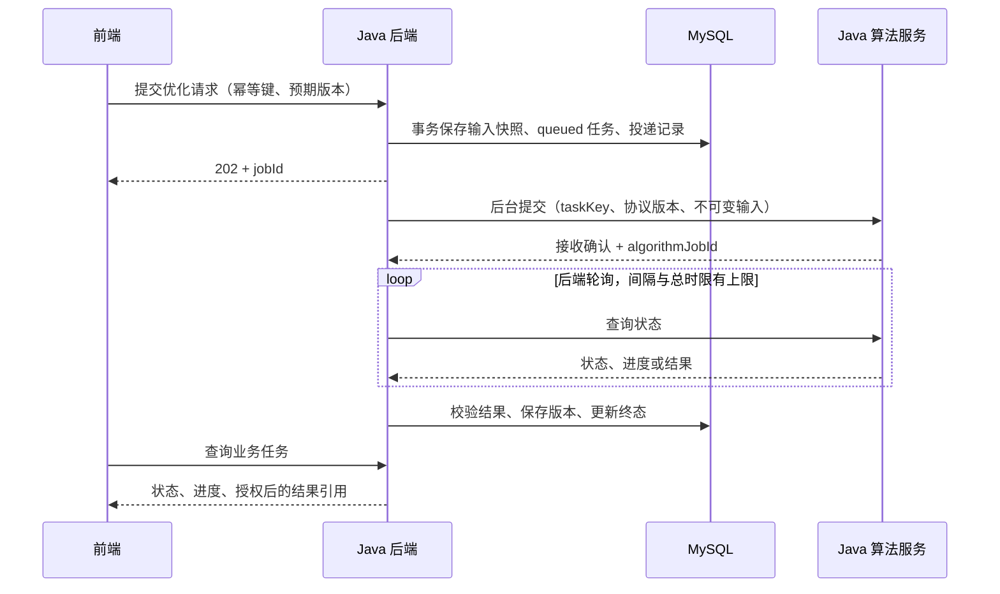

# 算法接入与任务设计

本文是待实施契约，不表示已有任务接口、调度器或 Java 算法服务。六个算法包统一 Java 17 / Maven，分别发布 JAR。计算核心不依赖 Spring，独立服务适配采用 Java / Spring Boot；不同业务域可独立部署。求解器的 Java 接入方式与性能验证待模型实现时确定，当前没有求解器依赖。

## 职责分配

前端提交业务参数和方案版本，展示校验、任务进度与结果。Java 后端负责授权、参数校验、快照、任务持久化、审批和结果归档。算法服务负责模型构建、求解及算法诊断。浏览器不直接调用算法服务；同步 REST 请求不等待长时间求解完成。

## 契约原则

算法输入采用有版本的 JSON 契约，至少明确：`taskKey`、`requestId`、`algorithmKey`、`modelVersion`、`inputSchemaVersion`、`snapshotId`、`businessVersion`、业务输入和求解时限。组织信息由后端授权后填入。浮点精度、金额/重量单位、时区和空值语义必须由各业务算法契约定义。

算法输出至少明确 `outputSchemaVersion`、实际模型/求解器版本、输入快照引用、求解状态、目标值/约束诊断和结果数据。结果落库前验证结构、版本、单位及领域约束。大体积明细可通过受控文件引用交付；不得允许算法回传任意 URL 让后端下载。

`algorithmKey + modelVersion` 映射到服务端配置的适配器和地址，不接受浏览器指定算法 URL。每个算法适配器实现稳定的应用端口；HTTP 协议、认证、连接超时、读取超时和响应映射留在基础设施中。只导出所需快照字段，保持任务可回放。

## 两套状态不可混用

- **任务执行状态**：与前端一致，`queued / running / succeeded / failed / cancelled`。`progress` 可为 `null`，无真实进度时不伪造百分比。
- **求解结论**：按算法契约使用 `optimal / feasible / infeasible / unbounded / time_limit / not_evaluated` 等。算法成功返回“无可行解”可以是执行成功，但不产生可发布方案；超时有无可行解必须另外说明。

取消请求应先记录请求时间，得到工作线程/算法确认后才进入 `cancelled`。若结果先完成，按持久化版本竞争确定终态，不由前端强行覆盖。业务审批状态和算法任务状态分开存储。

## 可靠性与扩展

1. 幂等键按组织、用户和操作范围约束；相同键且相同输入返回同一任务，不同输入返回冲突。算法端也按稳定 `taskKey` 去重。
2. 网络超时可能意味着算法已经接收任务。先用稳定键查询接收状态，再决定重试，避免重复求解。
3. 首期采用 MySQL 持久化任务队列和有界后台执行器。任务包含租约、心跳、尝试次数、下次重试时间；进程重启后可恢复，无需依赖内存队列或常驻前端页面。
4. 对短暂网络/服务错误有限重试并退避；参数错误、不可行结论和版本不兼容不自动重复提交。失败保留可解释原因，用户重试创建新的尝试记录。
5. 结果保存与终态更新以事务和版本条件保证一致。迟到或重复结果不能覆盖已有终态或较新方案。
6. 设置排队上限、并发上限、求解时限、输入大小限制和结果保留期。完整记录提交人、快照、模型版本和请求 ID。
7. 新算法上线先注册契约和适配器，完成契约测试、失败恢复与一条真实任务闭环，再开放前端入口。后续需要 SSE、回调或消息队列时扩展传输适配层，不改变领域模型；回调需要独立认证和防重放。

## 独立交付与分批验收

用户已确认驾驶舱、库存优化、采购优化、要货计划、成本核算、全程追溯与质量协同六个独立包，包内细分验收项。实现位置为同级 `scos算法/packages/`，见 [包边界与来源映射](../../scos算法/README.md) 和 [验收规则](../../scos算法/docs/acceptance-policy.md)。Java JAR 可离线验收计算核心，再单独验收 HTTP 服务和 Java 集成；Java 的 integration/algorithm 仅承担客户端适配，不能作为算法包本体。
